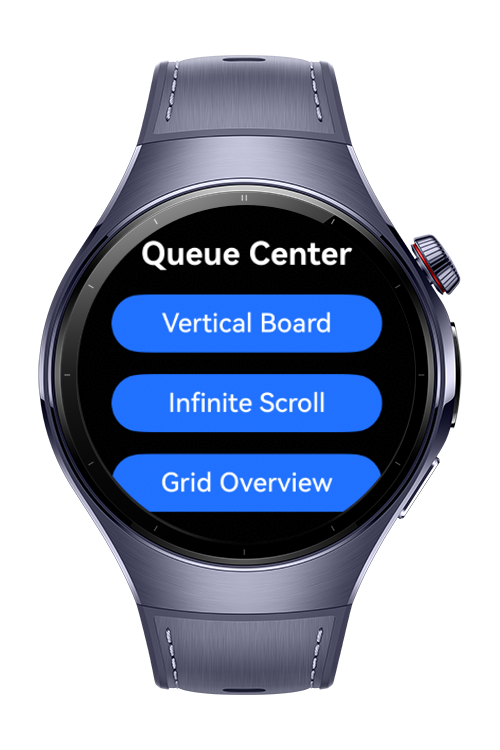
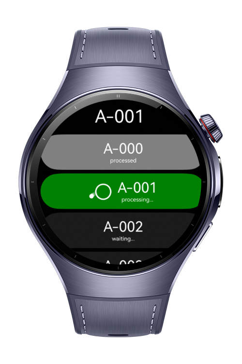
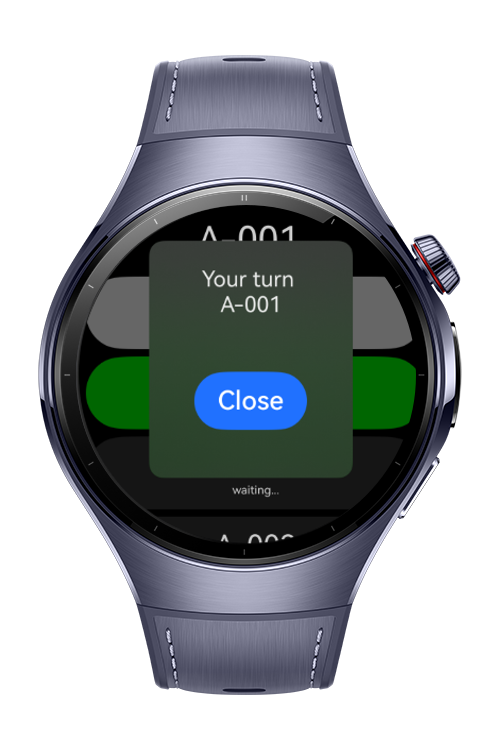

> **Note:** To access all shared projects, get information about environment setup, and view other guides, please visit [Explore-In-HMOS Index](https://github.com/Explore-In-HMOS/hmos-index).

# How to Build Queue Scrollboard on HarmonyOS

This codelab demonstrates how to create a HarmonyOS wearable queue scrollboard with **Grid**, **List** and **Scroll**.

# Preview
<div>
   
  
  
</div>

# Use Cases
**How to Build Queue Scrollboard** demonstrates how to implement various scrolling and queue scrolling on Huawei Watch 5 devices.

Practical scenarios include:

- **Queue Management Logic**: When an item is actioned (e.g., notification dismissed), the array must splice the item, 
and the scroll board must smoothly animate the remaining items up without losing the user's scroll position.

# Technology

## Stack
- Languages: ArkTS, ArkUI
- Frameworks: HarmonyOS SDK 6.1.0(23)
- Tools: DevEco Studio Vers 6.1.0.630
- Libraries
    - `@ohos.arkui.Prefetcher`

# Directory Structure
```
entry/src/main/ets/
|---components
|   |---GridComponents.etsna
|   |---HorizontalInfiniteComponent.ets
|---entryability
|   |---EntryAbility.ets
|---entrybackupability
|   |---EntryBackupAbility.ets
|---lib
|   |---utils.ets
|---pages
|   |---Index.ets
|---service
|   |---QueuePrefetcher.ets
|   |---QueueService.ets
|---model
|   |---QueueDataSource.ets
|---resources
|---module.json5
```

# Constraints and Restrictions

## Supported Device
- Huawei Watch 5

# License (MIT)
**How to Build Queue Scrollboard** is distributed under the terms of the MIT License. See the [LICENSE](/LICENSE) for more information.